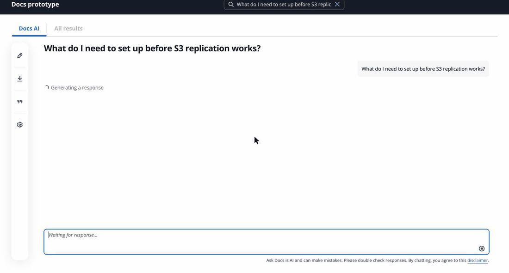
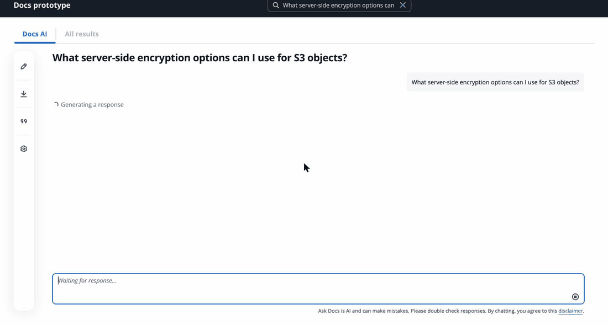
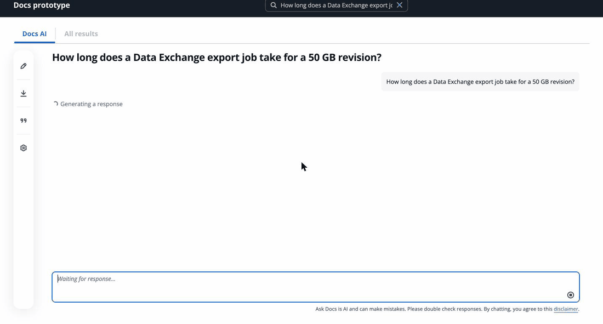
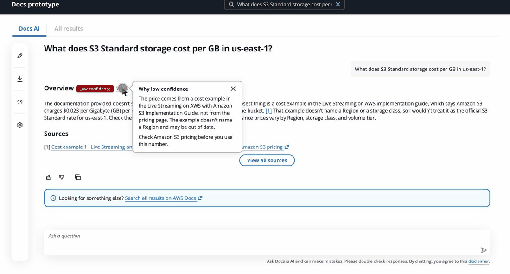
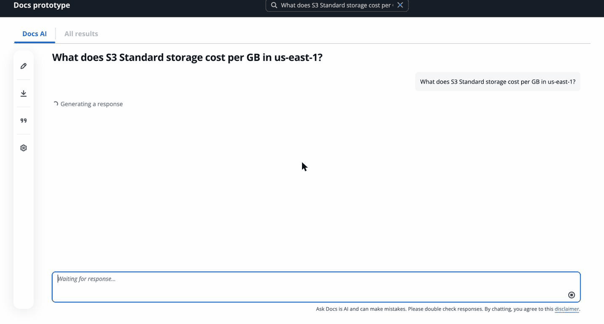

# Grounded Answers

Grounded Answers is my redesign of AWS Docs AI, the AI answer feature in the AWS documentation search. I'm a senior UX designer, and this is Demo 1 of a self-directed project where I learn to design and build AI products with Claude.

I audited AWS Docs AI on AWS Data Exchange and Amazon S3 pages. I found that you can't stop a response, it gives no sign of how confident it is, its source lists are noisy, and follow-up questions can lose or mix up context. This repo builds the fixes one component at a time. It uses Cloudscape (AWS's open source design system) inside the current Docs AI layout.

Try it live: https://grounded-answers-beryl.vercel.app

## Status

Demo 1 is done (Nov 4, 2026), and everything below runs on the live site. It answers from 25 doc sections about Amazon S3 and AWS Data Exchange, so ask about encryption, versioning, replication, or exporting Data Exchange data to S3. A question outside that set gets the no-answer hand-off.

### Stop a response

You can stop a response while it streams. The partial text stays, with the status "Stopped. This response is not complete." The Sources list shows only what the partial text cited, focus goes back to the prompt input, and you can regenerate once. The server also cancels the Claude stream, so nobody pays for text that no one sees. I checked that on the live Vercel server, not only locally.

### Sources that match the text

Each [n] points to a numbered source, and sources are numbered in the order the response first cites them. Up to 5 show under the response. "View all sources" opens a panel with the cited sources first and the rest of what Claude read under "Also read, not cited."

![A full response with [n] links, the Sources list, and the Sources panel opening.](docs/gifs/grounded-answers-2-sources.gif)

### Links to the exact section

Click an [n] to see the page, guide and section it came from. "Open section" opens the AWS docs page at that heading instead of the top of a long page.

![Clicking [3] opens a popover. Open section lands on the right heading of the AWS docs page.](docs/gifs/grounded-answers-3-section-links.gif)

### Follow-ups stay on the right item

AWS Docs AI got "Tell me more about the third one" wrong 3 times out of 3 in my tests. Here, code finds the third item in the list on screen and names it in the loading text and in the first words of the response. Claude only writes the rest. If the code can't tell which item you mean, it asks.

### A hand-off when the docs don't answer

When Claude finds no answer in the docs, or cites nothing, the response ends with the hand-off AWS Docs AI already uses: a link to search all results on AWS Docs.

### A confidence badge

Some doc text deserves less trust than the rest, so I flagged it. When a response cites flagged text, the Overview heading gets a badge: Low if every cited source is flagged, Medium if only some are. "Why?" says what's weak and what to check. In this doc set, one section has a flag: a cost example with a price that names no Region.

The badge shows only when the response ends, and it never changes after that. The trade-off is that on the price question you read the price a few seconds before the Low badge shows up. I chose that over a badge that could appear or change while you're still reading.

### Left out on purpose

The Next Steps questions that AWS Docs AI suggests under a response are not in this build. Adding them would have changed the prompt after I locked it for the evals, so they wait for a later round.

## What a question costs

Each question is one paid call to the Claude API (Claude Sonnet 5.5). A first question costs about $0.08, because it writes about 30,000 tokens of doc text to the prompt cache. The cache lasts 5 minutes, so a follow-up inside that window costs about $0.01, and a question after a quiet gap pays the $0.08 again. The live site has its own Claude Console workspace with a $10 monthly spend limit, which covers about 125 first questions.

## Eval results

I asked my build and the live AWS Docs AI the same 15 questions about Amazon S3 and AWS Data Exchange, plus a follow-up ("Tell me more about the third one.") 3 times. Each answer got Pass or Fail on three things: a correct answer, a source for every claim, and the right confidence signal on screen (a confidence badge, or the hand-off that says the docs don't have the answer). A question passes only if all three pass.

| | Grounded Answers (Nov 3) | AWS Docs AI (Oct 26) |
|---|---|---|
| All three pass | 7 of 15 | 1 of 15 |
| Correct answer | 14 of 15 | 11 of 15 |
| Every claim cited | 8 of 15 | 1 of 15 |
| Right confidence signal | 14 of 15 | 11 of 15 |
| Follow-up stays on the right item | 3 of 3 | 0 of 3 |

What this does and doesn't show:

- Each question ran once (the follow-up 3 times), so this is a result for a demo, not a statistic.
- My build reads 25 doc sections that I picked with these questions in view. AWS Docs AI searches all of the AWS docs. So this tests how the answer is designed and shown, not search.
- I set the grading rules before I read the answers, with one exception. At first, every sentence needed its own [n]. That failed every answer on both sides, so after a first read I changed it: one [n] covers the sentences before it in the same paragraph.
- AWS gave the same follow-up answer word for word all 3 times, so it may be one cached answer.
- My build's worst result was the Google Cloud question. The docs answer it (exports go only to S3 or a signed URL), but Claude marked it as "no answer", so the hand-off showed by mistake and the answer hedged instead of saying no. It's the one question where AWS did better. A fix would change the prompt, so it waits for a later round.

Grades, with a reason for each one: `evals/runs/2026-11-03-build/grades.md`. Questions: `evals/questions.md`. The 20 requests for my build cost $0.27.

## Built with

React, Vite, Cloudscape components, the Claude API (streaming with citations) and one Vercel function. I designed the states in Figma and built them with Claude Code. I used the Figma MCP server to inspect my frames, and found they were mostly pasted screenshots, so the build takes its structure from real Cloudscape components.

## Run it locally

You need Node 20.19 or later and your own Anthropic API key.

1. Run `npm install`.
2. Create a file named `.env.local` in the project folder with one line: `ANTHROPIC_API_KEY=your-key`
3. Run `npm run dev`, then open http://localhost:5173.

Each question calls the Claude API, so each one costs a small amount.

## Note

This is a personal portfolio project. It is not affiliated with or endorsed by Amazon Web Services. The doc text in `data/docs.json` is quoted from AWS documentation on docs.aws.amazon.com (the Amazon S3 User Guide and API Reference, the AWS Data Exchange User Guide and API Reference, and the Live Streaming on AWS with Amazon S3 Implementation Guide) and belongs to AWS.
